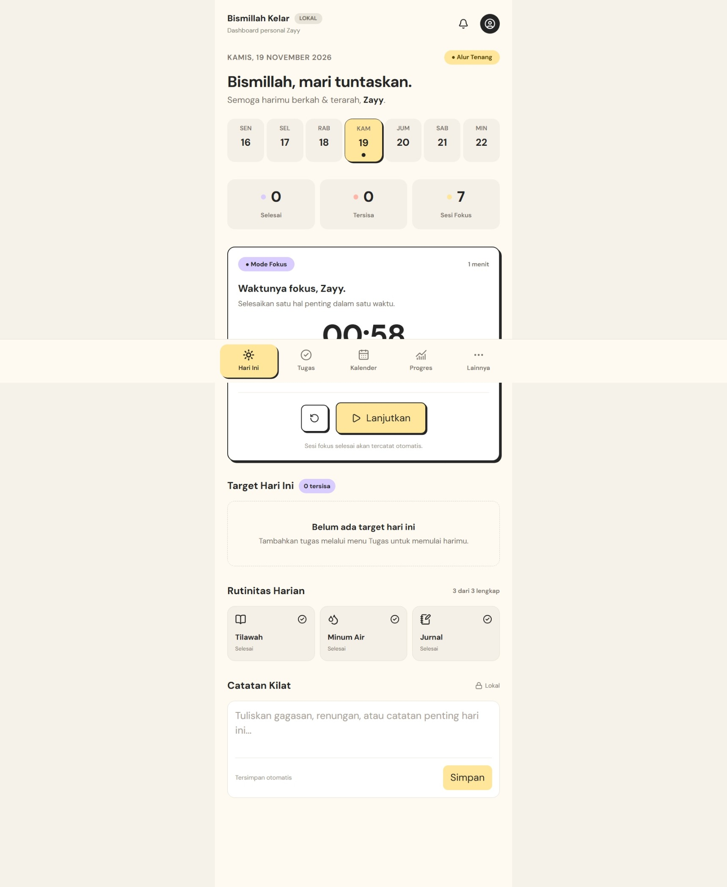
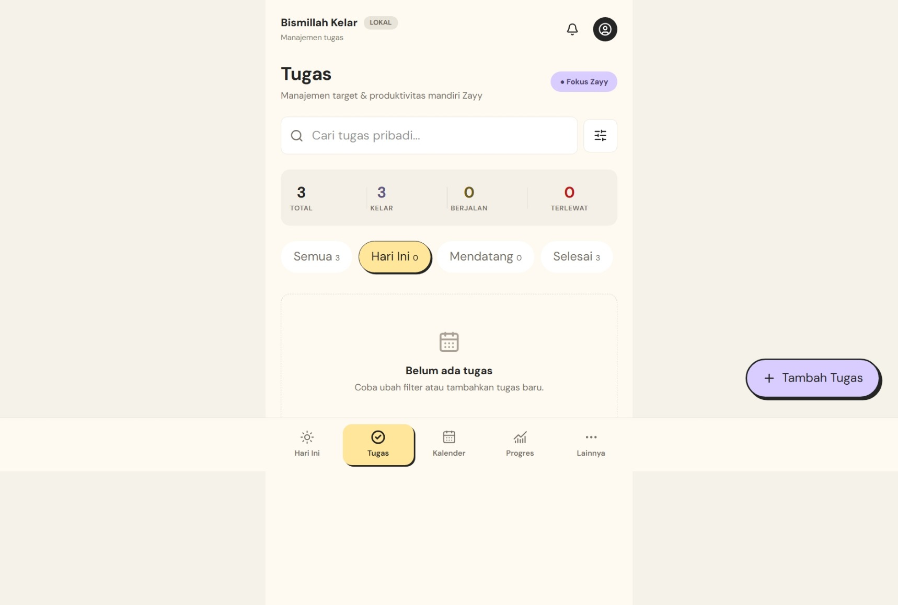
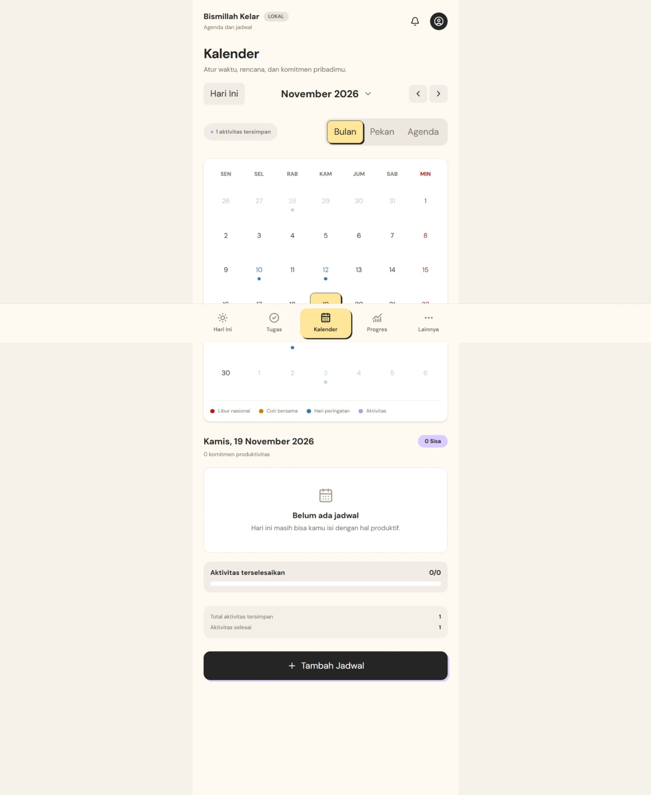
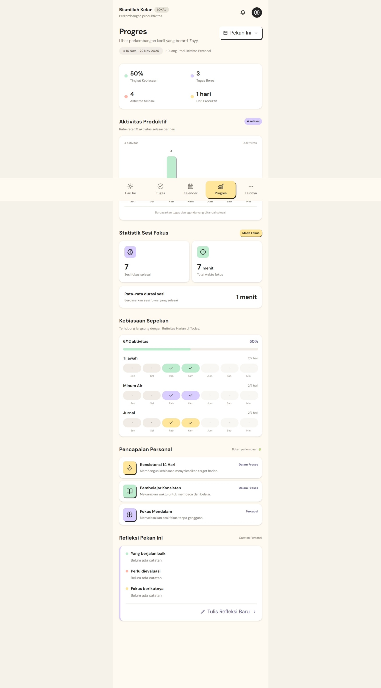
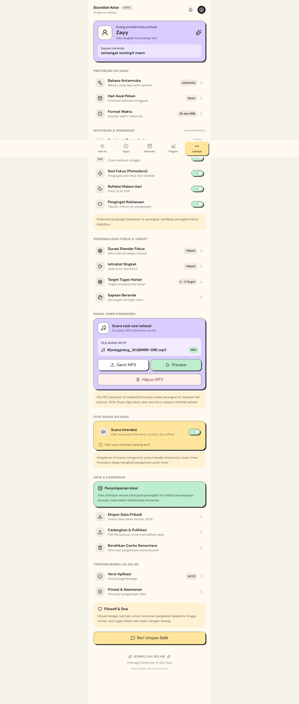

# Bismillah Kelar

**Bismillah Kelar** is an offline-first personal productivity application designed to help users organize daily activities, manage tasks, plan schedules, and maintain focus.

Built with React and TypeScript, this application is designed as a Progressive Web App (PWA), allowing users to access their productivity tools even without an internet connection after the application has been cached.

## Features

- **Today Dashboard** — View daily activities and productivity summaries.
- **Task Management** — Create, organize, and track tasks.
- **Calendar** — Manage schedules and view important dates.
- **Progress Tracking** — Monitor daily productivity and habits.
- **Focus Mode** — Use a Pomodoro timer to support focused work sessions.
- **Offline Support** — Access the application offline through PWA caching.
- **Local Data Storage** — Store application data in the browser.
- **Import & Export** — Back up and restore application data using JSON.
- **Audio Customization** — Upload and manage custom timer sounds.

## Application Preview

### Today


### Tasks


### Calendar


### Progress


### More


## Tech Stack

- React
- TypeScript
- Vite
- Tailwind CSS
- Lucide React
- vite-plugin-pwa
- IndexedDB
- LocalStorage

## Getting Started

### Prerequisites

- Node.js
- npm

### Installation

Clone the repository:

```bash
git clone https://github.com/zetzaynn/-bismillah-kelar.git
```

Navigate to the project directory:

```bash
cd -bismillah-kelar
```

Install dependencies:

```bash
npm install
```

Start the development server:

```bash
npm run dev
```

### Build for Production

```bash
npm run build
```

Preview the production build:

```bash
npm run preview
```

## Progressive Web App

Bismillah Kelar supports installation as a Progressive Web App (PWA).

Once deployed over HTTPS, users can install the application on supported devices and access its cached resources offline.

## Data Storage

Application data is stored locally using browser storage technologies:

- LocalStorage for application data.
- IndexedDB for custom audio files.

Data is stored in the browser on the device being used. Cross-device synchronization is not currently implemented.

## Project Status

**Version:** 1.0.0

**Status:** Personal project

---

Developed as a personal productivity project.